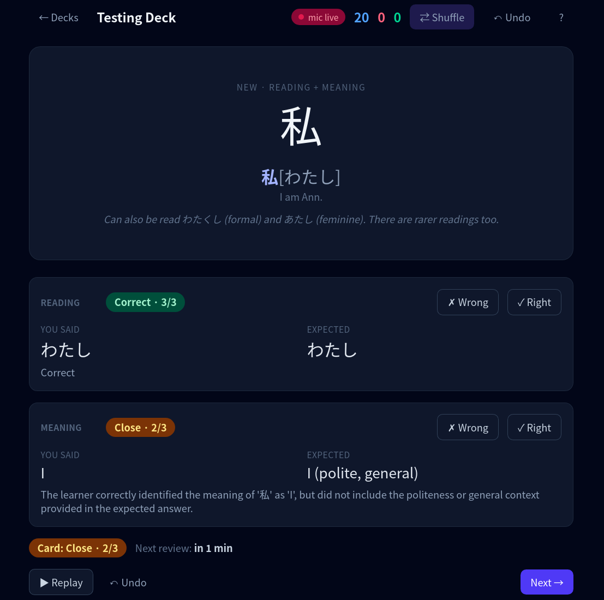

# Audio Flashcard

**This app is a work-in-progress for my personal language learning journey, and at this time has no published releases.**

A flashcard app for studying Japanese where you answer out loud instead of typing.



You see a word, say how it's read, then say what it means. The app checks both and tells you which part you got wrong.

In Anki you flip the card and grade yourself. Here you say the answer and the app grades it. Whisper (speech recognition) transcribes your reading and checks it against the card, and a local language model reads your English meaning and judges whether you understood the word, even if your wording differs from the card. You get feedback on each half, and the card is scheduled based on how you did.

Everything runs on your own computer. Nothing is sent anywhere, and once the models are downloaded you can use it completely offline.

## What it does

- Reading and meaning are graded separately. Saying 高い as たかい but calling it "cheap" counts as a miss, and the app tells you it was the meaning you got wrong.
- The meaning grader accepts any of the listed meanings and doesn't care about exact wording. It also uses the card's example sentence and notes to work out which sense of the word is meant. For example, 方 can be read ほう ("direction, side") or かた ("person", polite). The example sentence shows you which one the card means, and your meaning is graded against that sense.
- A Weak Spots screen shows how your reading accuracy compares to your meaning accuracy, and which cards you keep missing.
- Cards you miss come back sooner; cards you know get spaced further apart, much like Anki.
- You can import decks from CSV/TSV files or Anki's "Notes in Plain Text" export, and re-import an updated file later without losing your progress.
- Decks can be exported to a single file, progress included, and restored later.
- Not sure of an answer? Press "I don't know" and the app shows you the answer.
- Dark mode, and the whole interface can be scaled up or down (Ctrl + scroll, or Ctrl +/−/0).

## SRS algorithm

Scheduling works the way it does in Anki's classic (pre-FSRS) scheduler: SM-2 with learning steps. The difference is that you don't press Again, Hard or Good yourself. The app scores each answer from 0 to 3 and uses that score instead.

| Score | Meaning | Treated like |
| --- | --- | --- |
| 3 | Correct | Good |
| 2 | Close (a small slip in the reading, or a partly right meaning) | Hard |
| 1 | Wrong | Again |
| 0 | No real answer, or "I don't know" | Again |

On a card where you give both the reading and the meaning, the card gets the lower of the two scores. If the grade looks wrong, you can mark either half as right or wrong yourself, and the card is rescheduled to match.

**New cards** go through short learning steps, 1 minute and then 10 minutes by default. Good moves the card to the next step, Hard repeats the current step, and Again sends it back to the first step. After the last step the card graduates and comes back the next day.

**Graduated cards** are spaced out in days. The second review comes 6 days later, and after that each interval is the previous one multiplied by the card's ease (2.5 to start). Every review adjusts the ease: Good raises it a little, Hard lowers it, and Again lowers it more. It never goes below 1.3, so cards you find hard come back more often than cards you find easy.

**Missed cards** (a graduated card you got wrong) go through relearning steps, 10 minutes by default, and then start again from a 1-day interval.

Each deck has its own learning steps, relearning steps and daily limits (20 new cards and 200 reviews by default), and you can change them all in the deck's settings. Cards still in learning can be shown up to 20 minutes early, so you're not left waiting for a step to finish when there's nothing else to study.

## Getting it running (Linux)

You'll need Python 3, Node.js, [ollama](https://ollama.com), and a few system packages. On Ubuntu or Debian:

```bash
sudo apt install libportaudio2 python3-gi gir1.2-webkit2-4.1
```

PortAudio handles the microphone and playback; the other two let the app open its own window.

Then, from the project folder:

```bash
# Set up Python
python3 -m venv --system-site-packages .venv
.venv/bin/pip install -r requirements.txt

# Build the interface
cd frontend && npm ci && npm run build && cd ..

# Start the app
.venv/bin/python -m audioflash
```

The `--system-site-packages` flag matters: the windowing library (PyGObject) can't be installed with pip, so the virtual environment needs to see the copy apt installed.

The first time you start the app it downloads the speech model (Whisper "small", about 480 MB).

### Choosing a speech model

**Settings → Speech model** switches between Whisper models. The app downloads the one you pick and keeps using your current model until the download finishes.

| Model | Download | Notes |
|---|---|---|
| small (default) | ~480 MB | Fast on CPU, weakest Japanese |
| medium | ~1.5 GB | Better Japanese, 2–3x slower on CPU |
| large-v3-turbo | ~1.6 GB | Close to large-v3 for Japanese. Use it on the GPU (~1.2 GB VRAM); on CPU it takes several seconds per answer |
| large-v3 | ~3.1 GB | Most accurate, slowest |

On a 3070 Ti, large-v3-turbo on the GPU transcribes a short sentence in about 0.2 seconds and fits next to `qwen3:8b`, though with not much VRAM to spare.

Any other faster-whisper (CTranslate2) model works too: put its folder in `~/.local/share/AudioFlashcard/models/` and it shows up in the list under its folder name.

### Setting up ollama

ollama runs the language model that grades your meanings. Install it from [ollama.com](https://ollama.com), then download the default model:

```bash
ollama pull qwen3:8b
```

That's about 5 GB. Any other ollama model can be picked in Settings.

Using it is strongly recommended. Without ollama the app can't check meanings, so you'd only be able to study cards that ask for a reading. With a 3070ti (8GB VRAM), takes ~3 seconds for ollama and `qwen:8b` to generate a response for the meaning.

### Using your GPU (optional)

Speech recognition runs on the CPU by default, which is fine for most people. If you have an NVIDIA card and want it faster, install the CUDA libraries:

```bash
.venv/bin/pip install nvidia-cublas-cu12 nvidia-cudnn-cu12
```

then switch **Settings → Run Whisper on** to **GPU**. If something's missing, the app quietly falls back to the CPU and notes the problem in its log.

## Where your data lives

Your decks, progress, and settings are stored in `~/.local/share/AudioFlashcard`. The database is backed up automatically every time the app starts (the last 7 backups are kept), and the app holds on to your last 10 recordings for each card so you can listen back.

## For developers

To work on the interface with hot reload, run these in two terminals:

```bash
cd frontend && npm run dev              # serves http://127.0.0.1:5173
.venv/bin/python -m audioflash --dev
```

You can also open `http://127.0.0.1:5173` in an ordinary browser. There it talks to a fake backend instead of the real Python app, which is handy for layout work. The fake is left out of production builds.

Run the tests with:

```bash
.venv/bin/python -m pytest
```

The tests don't need a microphone, ollama, or the speech model; all of those are mocked.

A quick map of the code:

- `audioflash/` is the Python side: recording, transcription, grading, scheduling, and storage. `bridge.py` is what the interface calls into.
- `frontend/` is the React + TypeScript interface, built into a single `index.html`.
- `tests/` has the test suite.
- `packaging/` has a PyInstaller spec for building a standalone app (not fully tested yet).

## License

MIT
